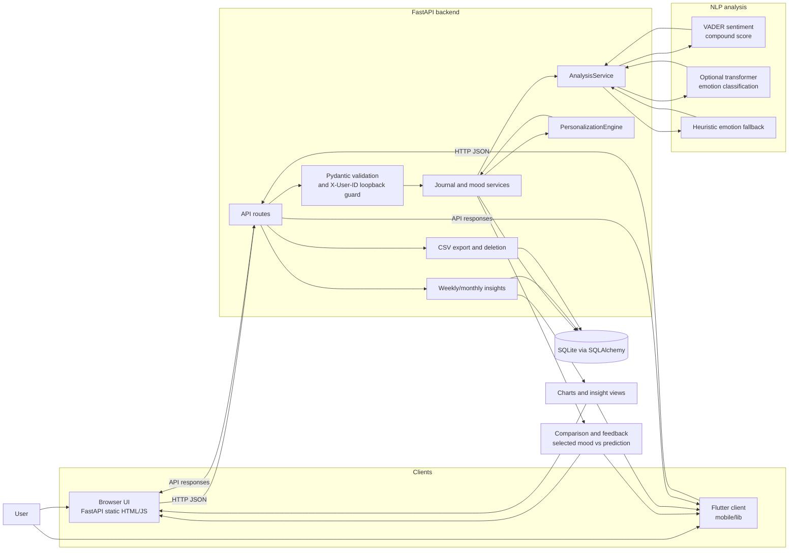

# Personalized AI-Based Mood Tracking and Journaling Application Using NLP

A local-first mood tracking and journaling application that stores journal
entries in SQLite, combines VADER sentiment analysis with optional
transformer-based emotion classification, and presents historical mood
insights. The project also contains offline GoEmotions-derived data
preparation, evaluation, and model-comparison experiments.

> **Important:** Predictions are automated estimates for personal reflection.
> They are not medical, psychiatric, or clinical diagnoses.

## Project overview

### Problem statement

People often record subjective moods without an easy way to compare their
self-selected mood with the language of a journal entry or review trends over
time. This project provides a small local application for recording that
context and inspecting model-assisted summaries.

### Research motivation

The repository separates the production-style application from offline
research. The application supports local inference and feedback. The research
artifacts evaluate a seven-label emotion task derived from GoEmotions and
investigate leakage-controlled evaluation, head-only transfer learning,
full-transformer feasibility, and class-imbalance robustness.

### Intended users

- Students and researchers demonstrating NLP-assisted journaling.
- Developers evaluating a local FastAPI and Flutter application.
- Individuals experimenting with private, local mood reflection.

This is not a hosted service, authentication product, mental-health treatment
tool, or clinical decision-support system.

### Current scope and limitations

- Default storage is a local SQLite database.
- The default launcher binds the backend to loopback.
- The local `X-User-ID` header provides a namespace boundary, not production
  authentication.
- Journal-domain performance has not been established. Offline emotion
  experiments use Reddit-derived GoEmotions text.
- The repository does not claim encryption, TLS, cloud backup, or clinical
  validation.

## Key features

The implemented browser application provides:

- Selection of one of eight moods: `happy`, `sad`, `stressed`, `anxious`,
  `angry`, `calm`, `excited`, or `neutral`.
- Journal entry creation, editing, retrieval, deletion, text search, and mood
  filtering.
- Optional analysis when an entry is created or edited.
- VADER compound sentiment scoring with `positive`, `negative`, or `neutral`
  polarity.
- Optional transformer emotion classification using
  `j-hartmann/emotion-english-distilroberta-base`.
- A local heuristic emotion fallback when the transformer is disabled or
  unavailable.
- Comparison of the selected mood with predicted sentiment and emotion.
- Prediction feedback: helpful confirmation or a corrected emotion.
- Local empirical-Bayes personalization after at least five feedback events.
- Weekly and monthly summaries, distributions, daily trends, and
  mood/sentiment alignment counts.
- Browser charts and distribution tables; the Flutter client uses `fl_chart`.
- CSV export and deletion of all records for the active local user.

The optional transformer model and the offline research checkpoints are not
required to start the browser application. The launcher explicitly disables
the transformer unless `MOOD_ENABLE_EMOTION_MODEL` is already set.

## Technology stack

| Area | Technology | Role |
|---|---|---|
| Browser UI | HTML, CSS, vanilla JavaScript | FastAPI-served desktop interface |
| Mobile UI | Flutter and Dart | Optional client for Android, desktop, or web |
| Backend | Python, FastAPI, Uvicorn | HTTP API, lifecycle, static-file serving |
| Validation | Pydantic v2 / pydantic-settings | Request, response, and environment validation |
| Persistence | SQLite and SQLAlchemy 2 | Local journal, analysis, correction, and preference storage |
| Sentiment | VADER (`vaderSentiment`) | Compound polarity score |
| Emotion | Hugging Face Transformers and PyTorch | Optional transformer inference |
| Fallback | Local lexical/heuristic logic | Emotion estimate when neural inference is unavailable |
| Charts | `fl_chart` in Flutter; browser JavaScript/CSS | Mood, sentiment, and emotion distributions |
| Testing | pytest, FastAPI TestClient, Flutter test/analyze | Backend and mobile validation |
| Offline research | pandas, NumPy, scikit-learn, PyTorch, Transformers | Dataset preparation, metrics, and experiments |

The backend requirements intentionally leave `transformers` and `torch`
commented as optional dependencies. Install them only when transformer
inference or the research scripts are needed.

## System architecture

The browser UI is served from `backend/app/static/index.html` by the same
FastAPI process that exposes the JSON API. The Flutter client communicates with
the API as a separate consumer. Requests are associated with a local user
namespace using `X-User-ID`; the default is `local-user`.

The backend performs the following processing:

1. Validate request data with Pydantic.
2. Resolve the local user namespace and enforce loopback access when enabled.
3. Persist journal entries and analysis records through SQLAlchemy.
4. Compute VADER sentiment.
5. Run the optional transformer or deterministic local fallback for emotion.
6. Apply feedback-based personalization only when enabled and enough prior
   corrections exist.
7. Return an entry/analysis response or aggregate persisted records for
   insights and export.

See the standalone diagram in
[`docs/system_architecture.md`](./docs/system_architecture.md).

## System architecture diagram



## Application workflow

1. The user selects a mood and writes a journal entry.
2. The client sends `text`, `mood`, optional `note`, and `analyze` to
   `POST /api/entries`.
3. The backend validates the fields and associates the request with the
   active local user.
4. If analysis is enabled, VADER computes sentiment polarity and the optional
   emotion model produces a primary/secondary emotion estimate. If the
   transformer is unavailable, the fallback maps positive, negative, or
   neutral sentiment to a small local distribution.
5. Existing feedback may adjust the stored emotion using bounded personalization
   after the five-event threshold. The original prediction is retained in the
   analysis record.
6. The API returns the saved entry, analysis, confidence information, model
   name, limitations, and any correction metadata.
7. The history view retrieves entries, searches text locally in the client or
   filters by mood, and supports edit, delete, and prediction correction.
8. The weekly and monthly insight endpoints aggregate stored entries into
   distributions, daily trends, alignment/divergence counts, agreement rates,
   and personalization metadata.

## Machine learning and NLP

### Sentiment versus emotion

Sentiment and emotion are different outputs:

- **Sentiment** is a three-way polarity category derived from the VADER
  compound score: positive at `>= 0.05`, negative at `<= -0.05`, otherwise
  neutral.
- **Emotion** is a categorical estimate. The optional local transformer is
  configured through `MOOD_EMOTION_MODEL_NAME`. The research benchmark uses
  seven Ekman-derived labels: anger, disgust, fear, joy, sadness, surprise,
  and neutral.

### Inference path

`AnalysisService` initializes VADER during import and loads the transformer
once during FastAPI startup when enabled. Transformer inference requests the
complete label distribution, stores the highest-scoring emotion, and may
expose a secondary emotion when the second score is sufficiently high or
close to the primary score. Moderate confidence and mixed emotions are
reported as explanatory metadata.

If `vaderSentiment` is unavailable, a small lexical sentiment fallback is used.
If the transformer is disabled, cannot be imported, or fails at inference,
the application uses a deterministic heuristic distribution based on sentiment.
The response marks fallback behavior with `is_fallback`.

Pretrained models can be wrong for sarcasm, slang, short context, mixed
emotions, and writing styles unlike their training data. The application does
not diagnose mental-health conditions.

## Dataset documentation

### Runtime application

The running application does not load the GoEmotions files at request time.
It stores user entries, analyses, corrections, and preferences in SQLite.

### Offline research dataset

The `dataset 1/` directory contains GoEmotions assets and scripts. The source
corpus is Reddit text with 27 emotion categories plus Neutral. The source
README documents 58,009 examples and agreement-filtered splits of 43,410
training, 5,426 validation, and 5,427 test rows. Raw CSV files contain
annotation metadata and separate binary emotion columns. Agreement-filtered
TSV files contain three columns without a header:

```text
text<TAB>comma-separated emotion IDs<TAB>comment ID
```

Repository preprocessing derives sentiment and seven Ekman-style labels. The
saved grouped benchmark combines the processed train/dev/test Ekman files,
groups identical text before splitting, unions labels within a text group, and
uses:

| Split | Grouped text groups |
|---|---:|
| Train | 43,196 |
| Validation | 5,399 |
| Frozen test | 5,399 |

The grouped split has zero exact-text overlap between any pair of splits.
These files are for offline research and are not private journal data.

## Research and evaluation

The completed grouped benchmark and model experiments are documented in:

- [`reports/research_experiment_final_report.md`](./reports/research_experiment_final_report.md)
- [`reports/experiment_3_model_comparison_report.md`](./reports/experiment_3_model_comparison_report.md)
- [`reports/experiment_4_full_finetuning_report.md`](./reports/experiment_4_full_finetuning_report.md)
- [`reports/experiment_5_robustness_report.md`](./reports/experiment_5_robustness_report.md)

On the identical frozen grouped test set, the existing pretrained Model A and
the Experiment 3 head-only Model B produced:

| Metric | Existing Model A | Experimental Model B |
|---|---:|---:|
| Macro-F1 | 0.4284 | **0.5405** |
| Micro-F1 | 0.4732 | **0.6171** |
| Weighted-F1 | 0.4908 | **0.6148** |
| Exact-match accuracy | 0.3988 | 0.4058 |
| Hamming loss | 0.1614 | **0.1332** |

Model B trained only the classification head with the transformer encoder
frozen. It used multi-label `BCEWithLogitsLoss`, validation-only threshold
selection, and a separate checkpoint. These are benchmark results on
Reddit-derived GoEmotions text, not equivalent performance claims for personal
journal entries.

Experiment 4 did not produce full-transformer results because available RAM
was insufficient for a safe full AdamW training run. Experiment 5 audited the
saved artifacts and ran a three-seed square-root class-weighted head variant.
That variant improved minority recall but underperformed Model B on overall
macro-F1 across all three seeds.

## Repository structure

```text
backend/
  app/
    main.py                 FastAPI routes, lifecycle, insights, export
    schemas.py              Pydantic request/response models
    models.py               SQLAlchemy journal, analysis, correction models
    database.py             SQLite engine and schema initialization
    config.py               MOOD_ settings
    services.py             VADER, transformer, and heuristic analysis
    personalization.py      Feedback-based Bayesian calibration
    static/index.html       Browser UI
  tests/                    Backend API and personalization tests
  requirements.txt          Backend dependencies
mobile/
  lib/                      Flutter application and API client
dataset 1/
  data/                     Raw and derived GoEmotions assets
  preprocessed/             Derived TSVs, labels, predictions, metrics
  *.py                      Dataset and offline evaluation scripts
research/
  evaluation/               Grouped benchmark and independent verifier
  experiment_3/              Head-only training and verification scripts
  experiment_4/              Full-fine-tuning feasibility preflight
  experiment_5/              Robustness and imbalance scripts
reports/
  grouped_text_benchmark/   Frozen splits and baseline predictions
  experiment_3/              Model B checkpoint and keyed predictions
  experiment_3*.md/json/csv  Experiment 3 reports
  experiment_4*.md/json/csv  Experiment 4 feasibility reports
  experiment_5*.md/json/csv  Experiment 5 robustness reports
run_app.ps1                  Windows browser launcher
stop_app.ps1                 Windows shutdown helper
docs/system_architecture.md  Standalone Mermaid architecture diagram
```

Generated databases, caches, `.runtime/` logs, Python bytecode, Flutter build
outputs, and large raw artifacts are omitted from this summary.

## Installation and setup

### Browser application

Prerequisites:

- Windows PowerShell.
- Python 3.11 or newer.
- Optional: `transformers` and `torch` for neural emotion inference.

From the repository root:

```powershell
Set-ExecutionPolicy -Scope Process Bypass
.\run_app.ps1
```

The launcher starts Uvicorn on `http://127.0.0.1:8000`, waits for
`GET /api/health`, and opens the browser. Use `.\run_app.ps1 -Port 8010` for
another port and `.\stop_app.ps1` to stop the listener.

For manual setup:

```powershell
python -m venv .venv
.\.venv\Scripts\Activate.ps1
python -m pip install -r backend\requirements.txt
python -m uvicorn app.main:app --app-dir backend --host 127.0.0.1 --port 8000
```

The interactive API reference is available at
`http://127.0.0.1:8000/docs`.

### Configuration

The backend reads `.env` and `MOOD_`-prefixed environment variables:

| Variable | Default | Meaning |
|---|---|---|
| `MOOD_DATABASE_URL` | `sqlite:///./mood_journal.db` | SQLAlchemy database URL |
| `MOOD_ENABLE_EMOTION_MODEL` | `true` | Attempt transformer loading |
| `MOOD_EMOTION_MODEL_NAME` | `j-hartmann/emotion-english-distilroberta-base` | Transformer checkpoint |
| `MOOD_CORS_ORIGINS` | localhost origins | Allowed CORS origins |
| `MOOD_MAX_JOURNAL_CHARACTERS` | `10000` | Configured journal length limit |
| `MOOD_BIND_HOST` | `127.0.0.1` | Server bind setting |
| `MOOD_ENFORCE_LOOPBACK` | `true` | Restrict requests to loopback |

The launcher sets `MOOD_ENABLE_EMOTION_MODEL=false` by default. To enable the
optional model in a prepared environment:

```powershell
python -m pip install transformers torch
$env:MOOD_ENABLE_EMOTION_MODEL = "true"
.\run_app.ps1
```

### Flutter client

From `mobile/`:

```powershell
flutter pub get
flutter analyze
flutter test
```

API base URL examples:

```powershell
# Android emulator
flutter run --dart-define=API_BASE_URL=http://10.0.2.2:8000

# Windows desktop or web
flutter run --dart-define=API_BASE_URL=http://127.0.0.1:8000
```

For a physical device, use the computer's LAN address and configure backend
binding, firewall, loopback enforcement, authentication, and TLS deliberately.
Do not expose the development service publicly as-is.

## API documentation

All API routes use the `X-User-ID` header when a namespace is needed; omitted
requests use `local-user`. Pydantic validation returns HTTP 422 for invalid
payloads. Entry ownership mismatches return HTTP 403, missing entries return
HTTP 404, and corrections without an analyzed entry return HTTP 409.

### Health and model

| Method | Endpoint | Purpose |
|---|---|---|
| GET | `/api/health` | Returns `{"status":"ok"}` |
| GET | `/api/auth/session` | Returns local user/session marker |
| GET | `/api/model/info` | Reports model availability and fallback state |

### Analysis and entries

| Method | Endpoint | Request/query |
|---|---|---|
| POST | `/api/analyze` | `{ "text": "...", "apply_personalization": true }` |
| POST | `/api/entries` | `{ "text": "...", "mood": "...", "note": "...", "analyze": true }` |
| GET | `/api/entries` | Optional `mood`, `from_date`, `to_date` |
| GET | `/api/entries/{id}` | Retrieve one owned entry |
| PUT | `/api/entries/{id}` | Same fields as entry creation |
| DELETE | `/api/entries/{id}` | Delete one owned entry; returns 204 |
| POST | `/api/entries/{id}/correction` | `{ "helpful": true }` or corrected emotion |

Example:

```powershell
Invoke-RestMethod `
  -Method Post `
  -Uri http://127.0.0.1:8000/api/entries `
  -Headers @{"X-User-ID"="local-user"} `
  -ContentType "application/json" `
  -Body '{"text":"I had a calm and productive day.","mood":"calm","analyze":true}'
```

An entry response contains `id`, `text`, `mood`, timestamps, optional `note`,
an `analysis` object, and optional correction information. Analysis includes
sentiment, compound score, emotion, confidence, model name, fallback status,
and limitation/personalization fields.

### Insights, export, and personalization

| Method | Endpoint | Purpose |
|---|---|---|
| GET | `/api/insights/weekly` | Aggregate the last seven days |
| GET | `/api/insights/monthly` | Aggregate the last 30 days |
| GET | `/api/export` | Download a sanitized CSV export |
| DELETE | `/api/data` | Delete all records for the active user |
| GET | `/api/personalization/status` | Read feedback and activation status |
| POST | `/api/personalization/toggle` | `{ "enabled": true/false }` |
| POST | `/api/personalization/reset` | Clear feedback calibration history |

Insight responses include entry counts, most frequent mood/emotion,
mood/sentiment/emotion distributions, daily trend, alignment/divergence,
feedback agreement rate, correction count, and personalization metadata.

## Testing and troubleshooting

Backend tests use an isolated SQLite URL and disable the transformer:

```powershell
python -m pytest backend\tests -q
```

The tests cover health and analysis, entry lifecycle, validation, ownership
isolation, correction rules, insights, CSV formula-injection sanitization,
deletion, personalization thresholds, temporal leakage prevention, and
cross-user personalization isolation.

Mobile checks:

```powershell
cd mobile
flutter analyze
flutter test
```

Common verified issues:

- **PowerShell activation blocked:** run
  `Set-ExecutionPolicy -Scope Process Bypass`, or use `run_app.ps1`.
- **Transformer unavailable:** leave it disabled; VADER and the local emotion
  fallback still provide analysis.
- **Mobile cannot connect:** use `10.0.2.2` for an Android emulator or a
  reachable LAN address for a physical device. Ensure the backend bind host
  and firewall permit the intended development connection.
- **Port already in use:** pass another port to `run_app.ps1` and use the same
  port in the client.

## Security, privacy, and ethics

Journal text is processed by the configured backend and stored in the
configured database. The default setup is local-first and loopback-bound, but
it does not claim encryption, TLS, or production authentication. CSV export
sanitizes spreadsheet formula-leading characters, but exported files still
contain journal content and should be handled privately.

`X-User-ID` separates local namespaces and supports ownership checks; it is not
an identity provider or secure authentication mechanism. Do not expose this
service to an untrusted network without adding real authentication,
authorization, TLS, encrypted storage, and operational controls.

GoEmotions is Reddit-derived and contains known demographic, annotator, and
content biases. Emotion predictions can be incorrect and should support
reflection rather than diagnosis, treatment, crisis assessment, or other
clinical decisions.

## Limitations and future enhancements

Current limitations:

- No consented journal-domain benchmark.
- No production authentication or encrypted database.
- Optional transformer loading can be resource-intensive.
- Exact-text research grouping does not remove semantic near-duplicates.
- Rare emotion classes have limited support.
- Full-transformer fine-tuning was not feasible on the measured host.
- Flutter's current insights screen consumes summary distributions; the
  browser UI provides the fuller local experience.

Future work:

- Collect a consented, de-identified journal-domain evaluation set.
- Evaluate longitudinal personalization with multiple users and seeds.
- Run full-transformer fine-tuning on a GPU/high-memory machine.
- Compare calibration, thresholding, and class-weighting strategies.
- Add production-grade authentication, TLS, encrypted storage, and migration
  management before any network deployment.

## Author and project information

This repository is a project and research artifact for a personalized
AI-assisted mood tracking and journaling application. Author name,
institution, course, supervisor, and contact details are intentionally left
as project-specific placeholders rather than invented here.

## License and attribution

Review the upstream GoEmotions license, paper, model card, and terms before
redistributing dataset or model artifacts. The repository's GoEmotions
documentation links to the original ACL paper and model card.
