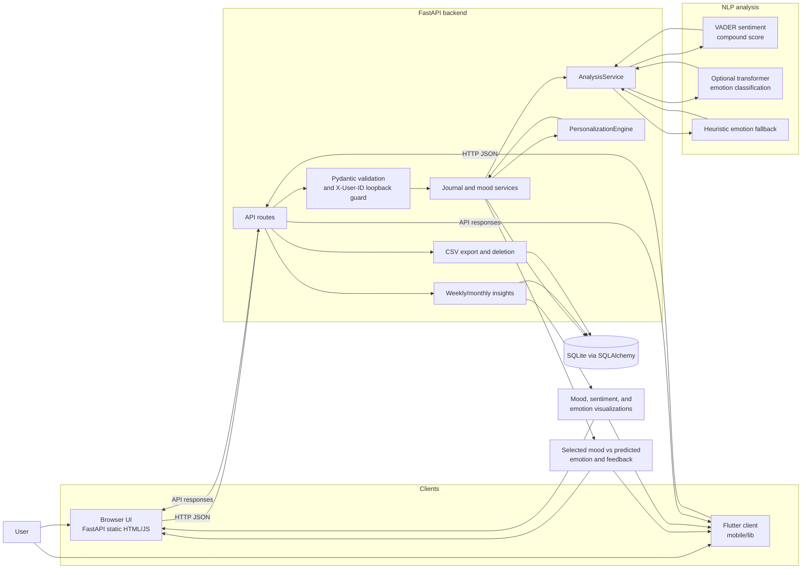

# System architecture

This diagram describes the implemented local application. The browser UI is
served by FastAPI from `backend/app/static/index.html`; the Flutter client is
an independent API consumer. The optional transformer and fallback are invoked
by `AnalysisService`, while persistence and aggregation remain in the backend.

## Main data flow

1. A client submits an entry or analysis request.
2. FastAPI validates the payload and resolves the local user namespace.
3. `AnalysisService` computes VADER sentiment and either transformer or
   heuristic emotion output.
4. `PersonalizationEngine` optionally adjusts the emotion using prior feedback.
5. SQLAlchemy persists journal, analysis, correction, and preference records in
   SQLite.
6. The API returns the saved result, or aggregates persisted records for
   insights and export.
